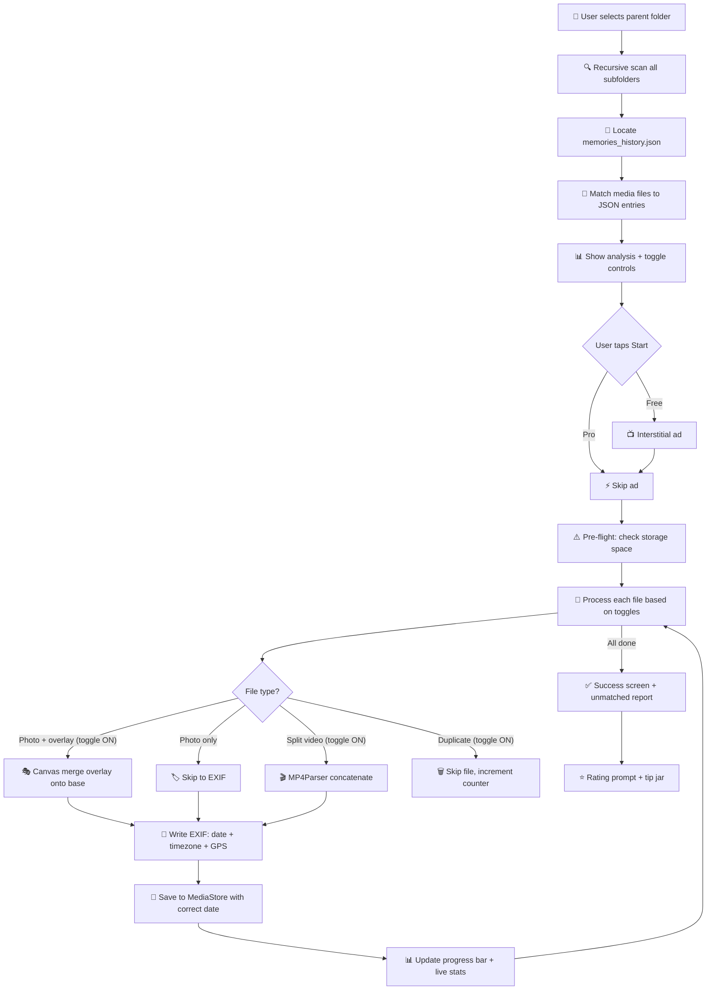

# 📸 MemoryFix — Final App Plan

> **App Name:** MemoryFix
> **Play Store Title:** `MemoryFix: Fix Photo Dates & Overlays`
> **Package:** `com.apadev.memoryfix`
> **Target:** Android 8.0+ (API 26+)

---

## 📛 Name Decision: MemoryFix

| Criteria | Status |
|---|---|
| Trademark safe | ✅ "Memory" and "Fix" are generic words |
| No Play Store collision | ✅ No exact match exists |
| Consumer-friendly | ✅ Non-technical, anyone understands it |
| ASO-friendly | ✅ Maps to "fix memories" — what users actually search |
| Memorable | ✅ Short, clear, action-oriented |

### Play Store Listing (Brand-Safe)

```
Title:       MemoryFix: Fix Photo Dates & Overlays
Short Desc:  Restore original dates, locations & overlays on exported photos
```

**Long Description (no brand names):**
> Fix photos from social media data exports! When you download your 
> memories from popular apps, photos often lose their original dates 
> and locations. Upload them to cloud photo services, and years of 
> memories all show up under today's date.
> 
> MemoryFix reads the metadata file from your export, matches it to 
> your photos, and restores everything — dates, GPS locations, emoji 
> overlays, and split videos — so your gallery shows memories in the 
> correct timeline order.
> 
> ✅ Restore original capture dates
> ✅ Embed GPS locations for map view
> ✅ Merge emoji/text overlays back onto photos
> ✅ Rejoin videos split into small clips
> ✅ Remove duplicate files
> ✅ Works with multi-folder exports
> ✅ 100% local processing — your photos never leave your device
>
> This app is not affiliated with any social media platform.

> [!TIP]
> **ASO strategy:** "Snapchat" never appears in the listing. It will naturally appear in user reviews (which Google indexes for search), and we can freely use it on our external website/blog under fair use. Users searching "fix snapchat export dates" will still find us through keyword signals like "memories", "export", "overlay", "dates", "fix".

---

## 💰 Monetization Strategy

### Ad Revenue Streams

| Ad Type | When | Duration | Details |
|---|---|---|---|
| **Banner Ad** | Always on free tier (bottom) | Persistent | Standard AdMob banner. Hidden in Pro. |
| **Interstitial Ad** | After "Start Fixing" tap, before processing begins | 15-30s (skip after 5s) | Natural transition point. User expects a brief wait. |
| **Rewarded Video** | Optional: "Watch ad to unlock date-organized folder export" | 15-30s | User-initiated. Highest eCPM (~$10-30 CPM). |
| **App Open Ad** | When returning to app from background | ~5s | Light, non-intrusive. |

### Frequency Caps
- Max **1 interstitial per processing session**
- Max **3 interstitials per hour** total
- **Never** during processing or on first launch
- Banner ads are constant but small

### In-App Purchase: Pro (₹299 / ~$3.50 one-time)

| Feature | Free | Pro |
|---|---|---|
| Process photos | ✅ Unlimited | ✅ Unlimited |
| Process videos | ✅ Unlimited | ✅ Unlimited |
| All fixes (dates, GPS, overlays, stitching, dupes) | ✅ | ✅ |
| Banner ads | ❌ Shows | ✅ Removed |
| Interstitial ads | ❌ Shows (before processing) | ✅ Removed |
| App Open ads | ❌ Shows | ✅ Removed |
| Organize output by date folders | ❌ (or rewarded ad) | ✅ |
| Batch Google Photos upload | ❌ | ✅ |
| Processing priority | Standard (ad wait) | Instant start |

> [!IMPORTANT]
> **Key differentiator vs FixMyExport ($14.99, 200-file free cap):** We offer **unlimited files for FREE** with ads. 4x cheaper Pro tier.

### Additional Revenue

| Method | Details |
|---|---|
| **Tip Jar** | "Buy me a coffee" (₹49/₹99/₹199) on success screen |
| **Affiliate** | Google One storage links from success screen |
| **Cross-Promo** | Promote Baby Monitor to users with kids |
| **Fun Stats** | "Your oldest memory: June 2018" — shareable, drives engagement |

---

## 🎨 UX Flow (5 Screens)

### Screen 1: Home

```
┌──────────────────────────────┐
│                              │
│     [MemoryFix Logo]         │
│                              │
│  Fix Your Exported Photos    │
│  Restore dates, locations    │
│  & merge overlays — FREE     │
│                              │
│  ┌────────────────────────┐  │
│  │  📁 Select Export      │  │
│  │     Folder             │  │
│  └────────────────────────┘  │
│                              │
│  Works with data exports     │
│  from social media apps      │
│                              │
│  🔒 100% local processing   │
│  Your photos never leave     │
│  your device                 │
│                              │
│  ━━━━━━━━━━━━━━━━━━━━━━━━━  │
│  [        Banner Ad        ] │
└──────────────────────────────┘
```

- User taps "Select Export Folder" → Android SAF folder picker opens
- App **recursively scans** all subfolders (handles multi-ZIP extractions automatically)
- While scanning, show a loading animation with "Analyzing your export..."

---

### Screen 2: Analysis & Controls (SCROLLABLE)

The **core differentiator** — shows a summary dashboard + toggleable processing cards.

#### Top: Summary Dashboard

```
┌──────────────────────────────┐
│  ← Back        Analysis      │
│                              │
│  ┌──────────────────────────┐│
│  │  📊 Your Export          ││
│  │                          ││
│  │  📷 1,247     🎬 384    ││
│  │  Photos       Videos    ││
│  │                          ││
│  │  📅 Jun 2018 → Mar 2025 ││
│  │  💾 12.4 GB   ⏱️ ~8 min ││
│  └──────────────────────────┘│
│                              │
│  🕐 Times will be set to:   │
│  IST (India) 🇮🇳  [Change]   │
│                              │
```

> [!NOTE]
> **Timezone** is auto-detected from device locale. Shown as info text with a small "Change" link — not a toggle. Tapping "Change" opens a timezone picker dropdown.

#### Middle: Toggle Cards

**4 toggleable features** — each as a Material3 card:

```
│  ── Choose What To Fix ─────  │
│                               │
│  ┌─────────────────────────┐  │
│  │ 📍 Embed Locations [🔵] │  │
│  │ 892 files with GPS data  │  │
│  │ Add location so photos   │  │
│  │ show on map view         │  │
│  │                          │  │
│  │ ⓘ What this does ▼      │  │
│  └─────────────────────────┘  │
│                               │
│  ┌─────────────────────────┐  │
│  │ 🎭 Merge Overlays [🔵]  │  │
│  │ 156 overlay pairs found  │  │
│  │ Combine stickers & text  │  │
│  │ back onto original photo │  │
│  │                          │  │
│  │ ⓘ What are overlays? ▼  │  │
│  └─────────────────────────┘  │
│                               │
│  ┌─────────────────────────┐  │
│  │ 📹 Stitch Videos  [🔵]  │  │
│  │ 23 split videos found    │  │
│  │ Rejoin long videos that  │  │
│  │ were broken into clips   │  │
│  │                          │  │
│  │ ⓘ Why are videos split?▼│  │
│  └─────────────────────────┘  │
│                               │
│  ┌─────────────────────────┐  │
│  │ 🗑️ Remove Dupes   [🔵]  │  │
│  │ 47 potential duplicates   │  │
│  │ Delete exact copies to   │  │
│  │ save storage. Originals  │  │
│  │ are never removed.       │  │
│  │                          │  │
│  │ ⓘ How we detect dupes ▼ │  │
│  └─────────────────────────┘  │
```

#### Toggle vs. Auto-Run Decision

| Feature | Toggle? | Why |
|---|---|---|
| **📅 Restore Dates** | ❌ **Always ON** | Core purpose of the app. No one downloads this and doesn't want dates fixed. Removing toggle reduces clutter. |
| **📍 Embed Locations** | ✅ **Toggle (ON)** | Privacy-sensitive — some users may not want GPS in photos they share. |
| **🎭 Merge Overlays** | ✅ **Toggle (ON)** | Some users want raw unedited photo + edited version separately. |
| **📹 Stitch Videos** | ✅ **Toggle (ON)** | Some clips work fine as 10-sec segments. |
| **🗑️ Remove Duplicates** | ✅ **Toggle (ON)** | Deleting is scary — user needs control. |
| **🕐 Timezone** | ❌ **Auto-detect** | Shown as info text with "Change" option. Not a toggle. |
| **🔍 Unmatched Report** | ❌ **Always shows** | Info shown at end if files couldn't be matched. |
| **⚠️ Pre-flight Check** | ❌ **Always runs** | Silent validation (storage space, JSON present, valid files). |

#### Expandable ⓘ Explainers (Collapsed by Default)

Each card has a tappable "ⓘ Learn more" that expands to show a visual explainer:

**📍 Locations explainer:**
> Your export has GPS coordinates in the data file, but they're not embedded in the photo. We add them so photos appear on map views:
> 📍 Miami Beach, FL · 📍 New York, NY · 📍 London, UK

**🎭 Overlays explainer (most important visual):**
> When you add stickers, emoji, or text, your export saves them as **2 separate files**:
> 
> `File 1:` Base photo (beach without emoji)
> `+`
> `File 2:` Transparent overlay only (😎🌴 "Summer vibes!")
> `↓`
> `Result:` Merged photo (beach WITH emoji and text)
> 
> **If OFF:** Both files are kept separately as-is.

**📹 Videos explainer:**
> Long videos are exported as multiple 10-second clips:
> `part1.mp4 + part2.mp4 + part3.mp4 → full.mp4 (30 sec)`
> **If OFF:** Parts stay separate.

**🗑️ Duplicates explainer:**
> We compare file fingerprints. Only exact identical copies are removed. Your originals are always safe.
> **If OFF:** All files kept, including duplicates.

#### Bottom: Summary + Start Button

```
│                               │
│  ─────────────────────────── │
│  📊 Based on your choices:   │
│  Files to process: 1,631     │
│  Estimated time:   ~8 min    │
│  Output: saved to Gallery    │
│  ─────────────────────────── │
│                               │
│  ┌─────────────────────────┐  │
│  │   🚀 Start Fixing       │  │
│  │   1,631 files (Free)    │  │
│  └─────────────────────────┘  │
│                               │
│  [        Banner Ad         ] │
└───────────────────────────────┘
```

> [!NOTE]
> **Smart behaviors:**
> - All toggles **ON by default**
> - If a category has **0 files**, toggle is **greyed out & disabled** with "None found"
> - **File count & ETA update live** as toggles change
> - **Start button text updates** dynamically ("1,631 files" → "1,475 files")
> - If JSON metadata found < media files found → show warning: *"We found metadata for 1,200 files but detected 1,631 media files. 431 files will have dates fixed based on filename only."*
> - If media files found < JSON entries → show nudge: *"Your metadata references 2,100 files but we only found 1,631. You may have more photos in other export folders."* + **"➕ Add another folder"** button

---

### Screen 3: Pre-Processing Interstitial Ad (Free users only)

```
┌──────────────────────────────┐
│                          [X] │
│                              │
│   ┌──────────────────────┐   │
│   │                      │   │
│   │   FULL SCREEN AD     │   │
│   │   (Interstitial)     │   │
│   │                      │   │
│   │   15-30 seconds      │   │
│   │   Skip after 5s      │   │
│   │                      │   │
│   └──────────────────────┘   │
│                              │
│   Your files are being       │
│   prepared...                │
│                              │
└──────────────────────────────┘
```

Pro users skip directly to processing.

---

### Screen 4: Processing (Live Progress)

```
┌──────────────────────────────┐
│        Processing...         │
│                              │
│  ┌──────────────────────┐    │
│  │ [current photo        │   │
│  │  thumbnail preview]   │   │
│  └──────────────────────┘    │
│                              │
│  summer_beach_2019.jpg       │
│  ✓ Date: Aug 14, 2019       │
│  ✓ GPS: Miami Beach, FL     │
│  ✓ Overlay merged            │
│                              │
│  ▓▓▓▓▓▓▓▓▓▓▓▓░░░░░░ 68%    │
│  1,089 / 1,631 files        │
│                              │
│  ⏱️ 3m 12s remaining        │
│                              │
│  ─── Live Stats ───────────  │
│  ✅ Dates fixed:     1,089   │
│  📍 Locations set:     702   │
│  🎭 Overlays merged:  104   │
│  📹 Videos stitched:   15   │
│  🗑️ Dupes removed:     23   │
│                              │
│  ⚠️ Keep app open            │
│                              │
│  [        Banner Ad        ] │
└──────────────────────────────┘
```

- Shows **thumbnail preview** of current file being processed
- **Animated progress bar** with percentage + file count
- **Live-updating stats** for each fix category
- **Foreground service notification** also shows progress (so user can leave app)

---

### Screen 5: Success Summary

```
┌──────────────────────────────┐
│                              │
│         ✅ All Done!         │
│                              │
│  1,631 memories restored     │
│  to their original dates     │
│                              │
│  ─── Summary ──────────────  │
│  📷 Photos fixed:   1,247   │
│  🎬 Videos fixed:     384   │
│  📍 Locations set:    892   │
│  🎭 Overlays merged:  156   │
│  📹 Videos stitched:   23   │
│  🗑️ Dupes removed:     47   │
│                              │
│  📅 Oldest: June 12, 2018   │
│  📅 Newest: March 3, 2025   │
│                              │
│  ⚠️ 12 files unmatched      │
│     (no metadata found)      │
│     [View details]           │
│                              │
│  ┌────────────────────────┐  │
│  │ 📤 Open in Gallery     │  │
│  └────────────────────────┘  │
│  ┌────────────────────────┐  │
│  │ ☁️ Upload to Google    │  │
│  │    Photos (PRO)        │  │
│  └────────────────────────┘  │
│                              │
│  ─────────────────────────── │
│  ❤️ Love MemoryFix?         │
│  ⭐⭐⭐⭐⭐ Rate us on Play    │
│  Store!                      │
│                              │
│  ☕ Buy us a coffee?         │
│  [₹49] [₹99] [₹199]        │
│                              │
│  [        Banner Ad        ] │
└──────────────────────────────┘
```

- **Unmatched file report** if any files had no JSON metadata match
- **Rating prompt** — great timing (user just had a positive experience)
- **Tip jar** — optional, feels earned after solving their problem

---

## 📁 Multi-ZIP Handling

### How Snapchat exports work (for large libraries):

```
User downloads:
  mydata~AAA.zip  ← Contains json/, html/, AND some memories/
  mydata~BBB.zip  ← Only memories/ (media batch 2)
  mydata~CCC.zip  ← Only memories/ (media batch 3)

The master memories_history.json is in ONLY ONE zip
but covers ALL files across ALL zips.
```

### Our approach: **Recursive folder scan + smart validation**

1. User selects the **parent folder** where they extracted all ZIPs
2. App **recursively scans** all `memories/` subfolders automatically
3. Automatically locates `memories_history.json` (or `memories_history.html`) wherever it is in the tree
4. Matches media files to JSON entries by filename/timestamp

**Smart validation messages:**

| Scenario | Message |
|---|---|
| **All matched** | "✅ All 1,631 files matched to metadata!" |
| **More media than JSON entries** | "⚠️ Found 1,631 files but metadata for only 1,200. 431 files will use filename-based dates." |
| **More JSON entries than media** | "⚠️ Metadata references 2,100 files but only 1,631 found. You may have more files in other folders." + **"➕ Add another folder"** |
| **No JSON found** | "❌ No metadata file found. Please make sure your export includes the JSON data file." + **"📖 How to export correctly"** tutorial link |
| **No media found** | "❌ No photos or videos found in this folder. Try selecting a different folder." |

> [!IMPORTANT]
> We do **NOT** handle ZIP extraction ourselves (too risky on Android with 10GB+ files, storage permissions, etc.). The user extracts on their PC/phone first, then points us to the folder. This is what FixMyExport does too — it's the standard approach.

---

## 🔧 Technical Architecture

### Core Libraries

| Library | Purpose |
|---|---|
| `androidx.exifinterface` | Read/write EXIF tags (DateTimeOriginal, GPS) on JPEG |
| `Gson` | Parse `memories_history.json` |
| `Android Canvas + BitmapFactory` | Composite overlay PNG onto base image |
| `mp4parser` (or `mobile-ffmpeg`) | Concatenate split video segments, fix muted audio |
| `SAF (Storage Access Framework)` | Folder picker — recursive scan |
| `MediaStore` API | Save fixed files to gallery with correct dates |
| `Google Mobile Ads SDK` | Banner, Interstitial, Rewarded, App Open ads |
| `Google Play Billing` | One-time Pro purchase |
| `WorkManager` | Background processing resilience |
| `Foreground Service` | Keep processing alive with notification progress |
| `Material3` | Premium UI components |

### Processing Pipeline



---

## 📋 Feature Roadmap

### v1.0 — MVP (Must-Have)

| Feature | Type | Details |
|---|---|---|
| 📅 Restore dates | Auto (always on) | Parse JSON → write EXIF `DateTimeOriginal` |
| 📍 Embed GPS locations | Toggle (ON default) | Parse JSON GPS → write EXIF GPS tags |
| 🎭 Merge overlays | Toggle (ON default) | Canvas composite overlay PNG onto base JPEG |
| 📹 Stitch split videos | Toggle (ON default) | MP4Parser concatenation |
| 🗑️ Remove duplicates | Toggle (ON default) | Hash-based dedup |
| 🕐 Timezone correction | Auto-detect + change | UTC → device timezone, with manual override |
| 📁 Multi-folder scanning | Auto | Recursive scan for multi-ZIP exports |
| ⚠️ Pre-flight validation | Auto | Check: JSON exists, valid media, enough storage |
| 🔍 Unmatched file report | Auto (shown at end) | List files with no metadata match |
| 💰 Banner + Interstitial ads | Free tier | AdMob integration |
| 💎 Pro IAP (₹299) | One-time purchase | Remove all ads, priority processing |

### v1.1 — Nice-to-Have

| Feature | Type | Details |
|---|---|---|
| 📁 Organize by date folders | Toggle / Pro | Output into `2019/June/` structure |
| 📋 Shareable export report | Auto | Fun stats card to share on social media |
| 🔇 Fix muted videos | Auto | FFmpeg audio remux for corrupted audio streams |
| ☁️ Google Photos upload | Pro | Direct batch upload with correct metadata |
| 🌙 Dark theme | All users | Material3 dynamic colors |

### v2.0 — Future Scope

| Feature | Details |
|---|---|
| Instagram Export Support | Similar metadata issues |
| WhatsApp Media Fix | Dates/locations stripped on forward |
| Facebook Export Support | Same broken export problem |
| Google Takeout Support | Fix dates from Takeout archives |

> [!TIP]
> Architecture should be **modular from day 1** — use a `Platform` interface so adding Instagram/WhatsApp support later is just implementing a new parser, not rewriting the app.

---

## 📈 Market Opportunity

| Metric | Value |
|---|---|
| Snapchat MAU | 800M+ |
| Forced to export (5GB cap) | Millions, growing |
| Main competitor | FixMyExport ($14.99, 200-file free cap) |
| Our free tier | **Unlimited** (ad-supported) |
| Our Pro price | ₹299 (~$3.50) — **4x cheaper** |
| Dev complexity | Medium-Low (simpler than Baby Monitor) |
| Time to MVP | ~2-3 weeks |
| Revenue model | Ads (free) + IAP (Pro) + Tips |
